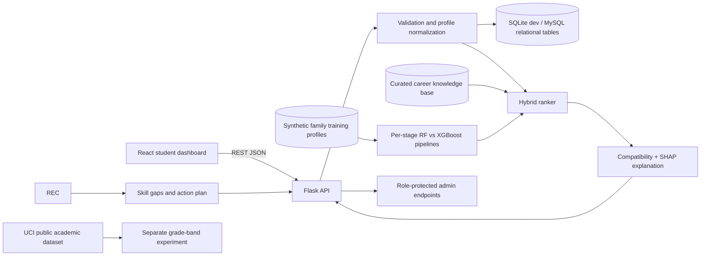
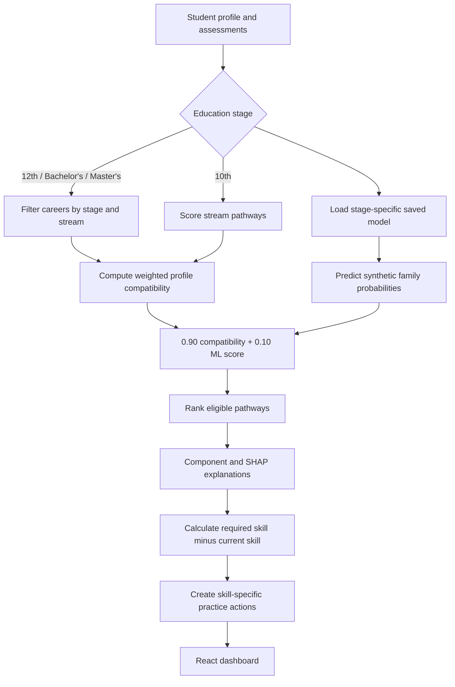
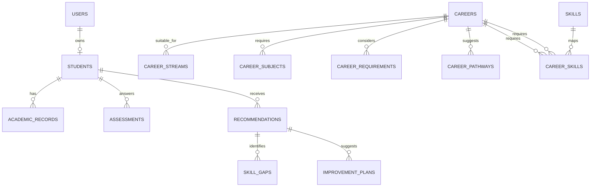

# Architecture



## Recommendation flow

Student profile → stage-specific feature pipeline and model family probabilities + stage-aware eligible career/stream set → academic, aptitude, interest, technical, employability, stream and education compatibility → `0.90 × knowledge/profile compatibility + 0.10 × model family probability` → ranked top results → component and SHAP explanation → career requirements and skill gaps → improvement actions. Class 10 results always include the four configured pathways in score order and use `backend/services/school_roadmap.py` to map maintained education routes, undergraduate program names, and stream-compatible longer-term career records into separate progression stages. Career records explain why a route is listed; local admission and recognition rules remain for official verification. The current family models use synthetic labels and are presented as experimental.

The combined score is a rank score, not a calibrated probability of career success. For 10th-standard profiles, each pathway uses only available evidence across relevant academic subjects (40%), scored aptitude (25%), interests (25%), and explicit preferences (10%); active weights are renormalized. The pathway requirements and subject/aptitude threshold of 60 are project guidance markers, not formal admission or psychometric standards. Unprovided evidence is excluded, not treated as zero. A provisional leader is named only with at least two evidence items and a 12-point score margin; differences under 8 points are treated as close. Otherwise the guidance explicitly says no single pathway stands out. Stage model family probabilities are grouped to broad pathways. For later stages, compatibility weights (academic, aptitude, interests, technical, employability, education, stream) are 12th: `20/18/23/13/9/10/7%`; Bachelor's/Master's: `16/17/18/20/12/8/9%`. Career-family model probabilities are trained on synthetic data only; their evaluation metrics do not estimate real-world accuracy. Education-stage filtering allows the next education stage as a prospective pathway.



## ML pipeline

Career: fixed-seed synthetic generation → stage-specific feature contract → stratified 80/20 split → train-fold fitted preprocessing → Random Forest and XGBoost comparison → 5-fold CV and held-out metrics → selected saved pipeline per stage → live probabilities and SHAP.

Separate public-data benchmark: official UCI CSV → validate target/features → exclude G1/G2/G3 from inputs → stratified train/test split → train-only preprocessing → baseline and Random Forest → 5-fold CV and held-out metrics. Its academic target is never used as a career label.

## Skill-gap flow

Career required skills → compare matching, observed profile ratings only → required minus current → low/moderate/high band → skill-specific actions. No defined requirements, no relevant observed ratings, and assessed ratings with no gaps have separate statuses. For 10th-standard pathways, only the pathway's relevant provided subject and aptitude scores are compared against documented project guidance markers; recommendations include age-appropriate practice and counselor/teacher discussion. Self-reported interests and skills are not treated as objective tests.

```mermaid
flowchart LR
  K[Career required skill scores] --> J[Join to student's reported skills]
  P[Student profile] --> J
  J --> D[Gap = max(required - current, 0)]
  D --> B{Gap size}
  B -->|1-14| L[Low]
  B -->|15-29| M[Moderate]
  B -->|30+| H[High]
  L --> I[Skill-specific improvement actions]
  M --> I
  H --> I
```

## Database ER diagram



MySQL DDL is in `backend/schema.sql`; a compact SQLite schema is created automatically for local setup. Academic marks and assessment dimensions are normalized score rows with composite keys. Users have student/admin roles; admin routes enforce role authorization. Admin routes currently provide user role management, career/skill catalog views, recommendation statistics and model metrics.
