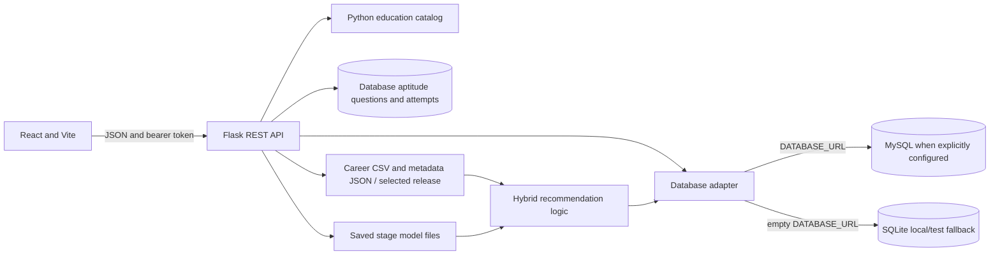

# CareerPath Phase 2.2E — Isolated MySQL Integration Plan

**Prepared:** 2026-10-22  
**Status:** Phase 1 read-only preparation complete. MySQL isolation gate is **BLOCKED**; no database connection or write was attempted.

## 1. Evidence reviewed

- Phase 2.2D and Phase 2.2D2 reports and the existing Phase 2.2D isolated integration plan.
- `backend/app.py`, `backend/database_config.py`, `backend/setup.py`, `backend/schema.sql`, and migrations `001_education_and_aptitude.sql` and `002_admin_observability.sql`.
- `tests/test_api.py`, `tests/test_setup_safety.py`, and the mocked MySQL adapter test.
- `SRS_IMPLEMENTATION.md`, `ARCHITECTURE.md`, `API_DOCUMENTATION.md`, `README.md`, and `SETUP_GUIDE.md`.

The repo contains the SRS implementation map and architecture documentation, but no standalone SRS or System Design PDF was found. Phase 2.2D2 also reports that the original documents were not available in the repository. SRS comparison here is limited to the implementation map and API/design documentation.

## 2. Runtime data flow and catalog ownership

With a configured MySQL `DATABASE_URL`, normal Flask requests use PyMySQL and persist accounts, profiles, assessments, aptitude attempt data, recommendation snapshots/events, API error rows, and Admin audit records in MySQL. With an empty `DATABASE_URL`, `CAREERPATH_DB` selects a local SQLite file; if that is also absent, the app resolves `careerpath.sqlite3` under the project root. The automatic SQLite fallback must not be used as evidence of MySQL integration.

The education endpoint currently returns a deep copy of `backend/education_catalog.py`; it does not read the education lookup tables. Aptitude questions and attempts are database-backed. The recommendation engine reads the career CSV/metadata pair (canonical bootstrap or one versioned release) and saved model artifacts from the filesystem. It writes recommendation results and events through the database adapter. Career/skill Admin editing stages file-backed catalog drafts and releases. The SRS implementation map and `backend/schema.sql` describe relational career/skill/gap tables, but the current Flask catalog/recommendation path does not use those tables as its source of truth.

### Catalog ownership matrix

| Data | Runtime source/consumer | MySQL use |
|---|---|---|
| Education levels, streams, degrees, specializations, subjects | `backend/education_catalog.py`; `/api/education/catalog`, profile validation, frontend catalog mapping | Lookup-table seed/init code exists, but the current education API reads Python data. |
| Aptitude questions, attempts, responses, domain results | `backend/aptitude_bank.py` is an explicit seed/test fixture; Flask aptitude endpoints query live DB rows | Yes. Seed fixture is not an automatic startup operation. |
| Career records, metadata, requirements, qualification guidance | `data/career_knowledge_base.csv`, `data/career_metadata.json`, and managed releases; `backend/services/catalog_releases.py` and recommendation engine | No, not for current recommendation reads. The corresponding tables in `schema.sql` are not created by the current MySQL branch of `init_db()`. |
| Saved model pipeline and metrics | `backend/models/career/*.joblib`, `data/processed/career_model_metrics.json` | No; read from files. |
| Accounts, profiles, subject ratings, assessment dimensions | Flask routes in `backend/app.py` | Yes. |
| Recommendation snapshot/events and API error/audit events | Flask recommendation/admin/error handling in `backend/app.py` | Yes. |
| Skill gap and improvement output | Calculated by recommendation/skill-gap services from profile and file catalog; included in recommendation JSON | No normalized skill-gap rows are written by the current runtime flow. |

## 3. MySQL tables, constraints, and initialization

### Runtime tables created by the MySQL `init_db()` branch

Source: `backend/app.py::init_db` (lines around 114–158). The runtime DDL creates or upgrades users, students, academic records, assessments, recommendation snapshots, aptitude questions/attempts/attempt questions/responses/domain scores, education lookup/mapping tables, recommendation events, API application errors, and Admin audit logs. It queries `information_schema` for legacy assessment detection and existing columns. It checks for a legacy `assessments` table before DDL and stops if the old shape would trigger an unsafe rename.

The key relational constraints include unique user email/token, unique student-to-user link, composite keys for academic/assessment values and aptitude attempt question ordering, and foreign keys from profiles/records/attempts/recommendations/events/audit rows to owning records. `schema.sql` additionally declares score `CHECK`s, career/skill mapping tables, and named indexes. Do not infer that those additional constraints/tables are installed by `init_db()`; compare the actual schema after owner-approved initialization in the disposable schema.

### Important schema discrepancies and risks

1. `backend/schema.sql` starts with `CREATE DATABASE IF NOT EXISTS careerpath` and `USE careerpath`. It must **not** be run as-is for this test; it would address the live-named schema instead of the owner-designated test schema.
2. Both migration files include `USE careerpath`. Do not execute them for this test. Their target cannot be changed safely by an environment variable.
3. The app's MySQL `init_db()` path does not create all tables in `schema.sql`, including the relational career/skill/skill-gap/improvement-plan tables. This agrees with the current file-based recommender, but conflicts with portions of `SRS_IMPLEMENTATION.md` that claim those records are MySQL-backed. Resolve/document that scope before treating those tables as a MySQL acceptance requirement.
4. MySQL DDL implicitly commits and is not an atomic schema transaction. A failed `init_db()` can leave a partially initialized schema. The target therefore must be disposable and empty, and its owner must approve the initialization command.
5. `init_db()` contains repeated `CREATE TABLE IF NOT EXISTS` statements for recommendation events and API errors. They are idempotent in the ordinary existing-table case but indicate the initializer and standalone DDL need a reviewed reconciliation.
6. Runtime FK actions differ from `schema.sql` in places. For example, initializer definitions omit some `ON DELETE CASCADE` clauses shown in `schema.sql`; cleanup must not assume cascades. Use an explicitly recorded child-to-parent cleanup plan inside the isolated schema only.

### Migrations and explicit setup

`backend/setup.py` has mutually exclusive `--schema`, `--seed-education`, `--seed-aptitude-fixture`, and `--bootstrap-admin` mutation actions. Before a mutating action it resolves the configured target, blocks the exact `careerpath` database name, requires `--confirm-target` to equal the credential-free resolved identity, and requires `--allow-non-test-target` for a target not recognized by the test-name convention. The displayed target contains driver, host, and schema/database, not credentials. The `--validate-catalogs` action is file validation and does not require a DB target.

`--seed-education` inserts missing Python education lookup rows. `--seed-aptitude-fixture` uses `INSERT IGNORE`/`INSERT OR IGNORE`; existing IDs are not overwritten. Neither seed is run automatically at application startup. No Admin bootstrap is needed or authorized for this integration pass.

## 4. Database-specific implementation behavior

`backend/database_config.py::resolve_database_target` accepts MySQL URLs with `mysql://` or `mysql+pymysql://`, and local file SQLite URLs. For MySQL it requires host, one schema name, a username, and no query or fragment; default port is 3306. `backend/app.py` loads `.env` without overriding environment variables, then uses `DATABASE_URL`. The application account should have privileges only on the test schema.

`MySQLConnection.execute()` converts `?` placeholders to `%s` and uses PyMySQL `DictCursor` rows. Several writes branch by dialect:

- MySQL `INSERT IGNORE` vs SQLite `INSERT OR IGNORE` for fixture/catalog lookup rows.
- MySQL `ON DUPLICATE KEY UPDATE` vs SQLite `ON CONFLICT ... DO UPDATE` for assessment and recommendation upserts.
- MySQL `information_schema` queries vs SQLite `PRAGMA table_info` for schema checks.
- MySQL `AUTO_INCREMENT`, `ENUM`, `JSON`, InnoDB foreign keys vs SQLite integer primary keys, text JSON, checks, and `PRAGMA foreign_keys=ON`.

`MySQLConnection` exposes `execute`, `commit`, and `close`; there is no explicit rollback wrapper. Flask stores one connection in `g` per request and closes it at teardown. Write routes commit individually. Registration inserts account and student within one request before a commit; aptitude submission inserts responses/domain scores/assessment values and updates attempt status before one commit. Profile, interest, technical/employability, and recommendation calls are separate HTTP requests and are not one atomic multi-request transaction. The API error handler may insert an `application_errors` row and commit after an HTTP error, so test cleanup must account for test-created error records as well.

## 5. Environment inputs (names only)

- `DATABASE_URL`: required for a MySQL run, with scheme, host, port, test schema, and dedicated test username; secret value must remain private.
- `CAREERPATH_DB`: only the SQLite fallback path when `DATABASE_URL` is empty; set it to an isolated path if SQLite tests are run. It does not redirect MySQL.
- `PORT`: Flask listening port; not relevant to a Flask test-client run.
- `ADMIN_EMAIL` and `ADMIN_PASSWORD`: used only by the explicit Admin bootstrap routine; leave unset and do not bootstrap an Admin for this plan.

Do not read, print, or copy `.env` contents into logs or reports. In a prepared test environment, supply credentials through the approved secret/environment mechanism and print only the resolved driver, host, port, and schema identity. Confirm the host/port/schema with the database owner before any connection.

## 6. Existing tests and suitability

`tests/test_api.py::ApiTests.setUp` always points `application.DB_PATH` to a `TemporaryDirectory`, copies the catalogs to that directory, redirects release paths, and calls `init_db()` and fixture seeds. It does not reset `USE_MYSQL`. If run with a MySQL `DATABASE_URL`, `init_db()` follows its MySQL branch and connects to the configured database despite the SQLite path override. Therefore do **not** run this test class against MySQL. Its MySQL adapter coverage (`test_mysql_adapter_uses_named_rows_and_mysql_placeholders`) is a mock and proves only placeholder conversion/dict rows, not a live connection or schema compatibility.

Phase 2.2D2 selected six API tests and seven frontend tests against isolated SQLite. Those are SQLite/API evidence only; no MySQL check is inferred from them.

## 7. Phase 3 procedure after the isolation gate

Proceed only after all owner-provided prerequisites in §8 are recorded. Do not use `backend/schema.sql` or either `USE careerpath` migration. For the separately approved, owner-created empty test schema:

1. Set `DATABASE_URL` to the owner-provided test URL in the test process without recording its credentials. Verify the parsed driver, host, port, schema, username presence, and `is_test_target()` result without opening a connection; reject `careerpath` and any ambiguous identity.
2. Obtain explicit owner approval for `python -m backend.setup --schema --confirm-target "<exact credential-free target identity>"`. The setup command validates its target before connecting. It will execute MySQL DDL and may partially initialize on failure.
3. If the aptitude workflow is in scope, obtain explicit approval for the separately confirmed `--seed-aptitude-fixture` command. Do not call `bootstrap_admin` or seed education lookup rows unless a demonstrated endpoint dependency requires them.
4. Do not run `tests/test_api.py` with MySQL. Add/use an isolated MySQL integration harness that does not override `USE_MYSQL` or change DB target after preflight. Keep API operations in uniquely named `@example.test` accounts.
5. Verify schema/table presence and required indexes/FKs after initialization; verify registration/login/identity, profile and all assessment writes, aptitude scoring, recommendations, skill-gap responses, logout, invalid-input handling, cross-account denial, and anonymous/student Admin denial. Make repeated requests/connections to establish persistence and test the dialect-specific upserts.
6. Record pre-run counts/IDs for any test-owned log/event rows that are generated. Clean up only test identities and rows created by this run, in FK-safe order, then verify those IDs are gone. Do not drop the schema unless the owner expressly authorizes it; do not touch any other rows.
7. If any resolved target differs from the approved identity, or a query reveals production/student data, stop immediately without adapting the target or cleaning unrelated rows.

The exact target string and initialization approval are currently missing, so no Phase 3 command is authorized or provided as an executable target command.

## 8. Isolation gate — not satisfied

| Prerequisite | Current evidence | Status |
|---|---|---|
| Owner-provisioned disposable test schema | No schema name/owner confirmation provided in Phase 2.2D or D2. | BLOCKED |
| Dedicated account scoped only to that schema | No test account or permission evidence provided. | BLOCKED |
| Explicit approval to initialize that schema | No initialization approval for a specific target provided. | BLOCKED |
| Exact driver, host, port, schema verifiable before connection | No target identity supplied. | BLOCKED |
| Target demonstrably separate and free of production/student data | No owner attestation or read-only preflight evidence available. | BLOCKED |

**Decision:** Stop after preparation. Do not connect, initialize, seed, or attempt a probe connection. No credentials or database configuration values were exposed.

## 9. Acceptance criteria and outstanding compliance

Phase 3 is acceptable only when target preflight and owner approval are recorded, DDL is verified in the disposable schema, the live MySQL workflow matrix passes, cross-account and role denials pass, data survives independent requests, test-owned records are cleaned, and no production data is touched. Mock adapter tests and temporary SQLite tests do not satisfy MySQL acceptance.

Still unverified: real MySQL schema initialization and migrations; runtime persistence and transaction behavior on MySQL; successful active-Admin workflows; React browser rendering/console and responsive/accessibility behavior; production catalog activation/storage/recovery and deployment. The current data-ownership mismatch between the SRS implementation map/schema and file-based career/skill runtime remains a documentation/architecture question; the current integration must not silently populate the unused MySQL career/skill tables.
